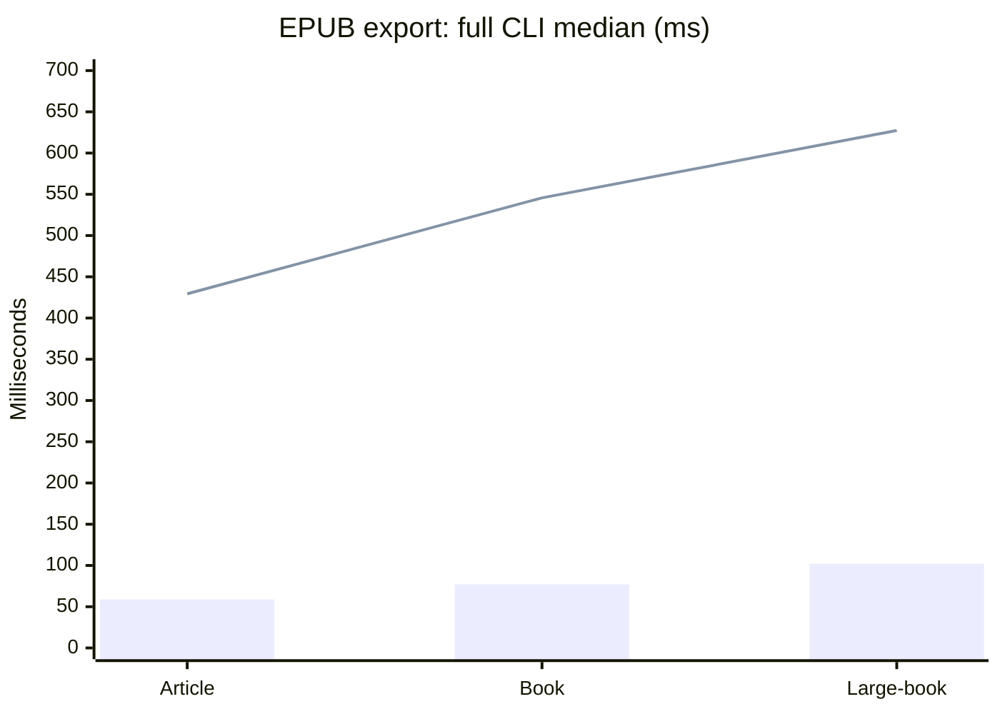
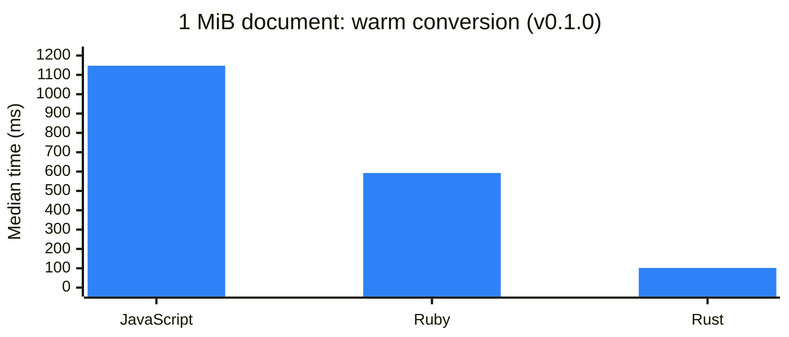
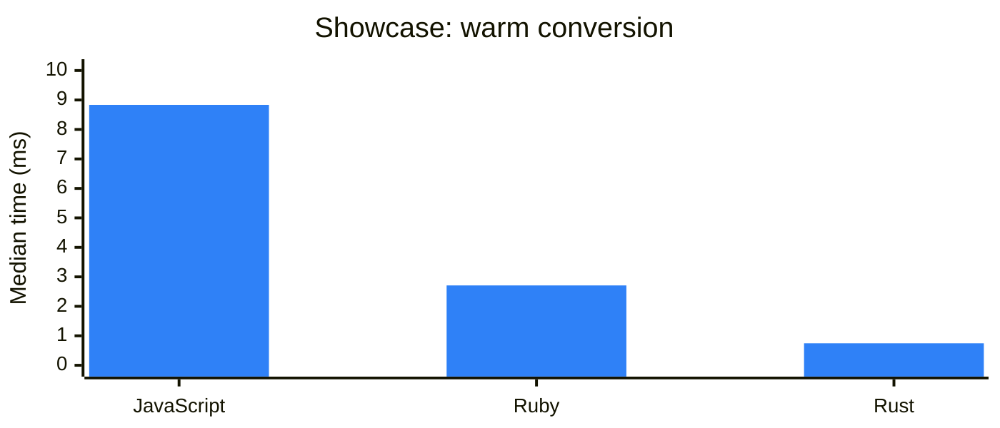
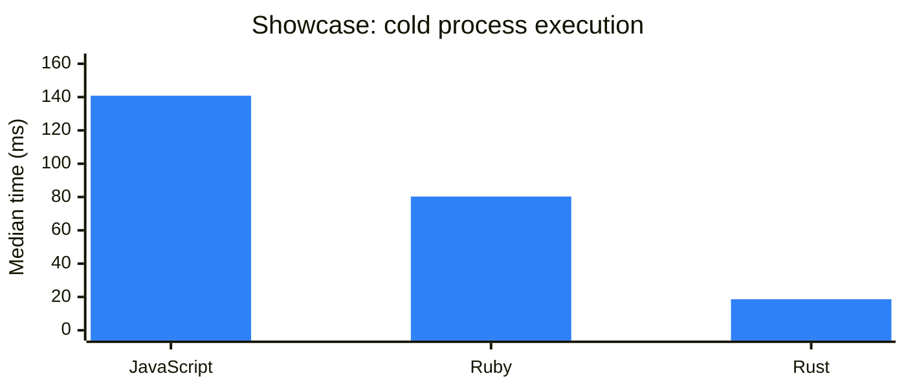
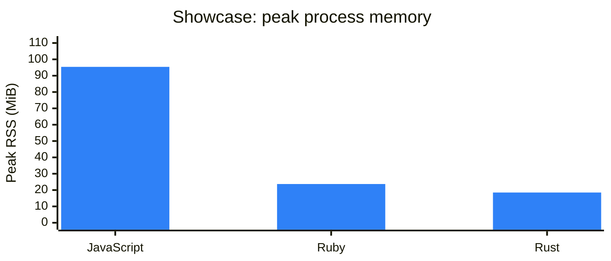

# adoc-engine

A fast, MIT-licensed Rust AsciiDoc engine with a library, CLI, and stdio language server.
Render HTML, PDF, EPUB 3, SVG, merged SVG, PNG, and JSON without installing Ruby,
Node, a browser, fonts, or an external typesetter. Node and Ruby are used only for
reference compatibility and performance verification.

## Install and run

Download the archive for your platform from [Releases](https://github.com/Jetplugins/adoc-engine/releases),
verify its SHA-256 checksum, and put `adoc-engine` on your PATH. macOS users may need
to authorize the unsigned executable through their operating system's normal security UI.
Build from source with Rust 1.96 or newer:

```sh
cargo build --release --locked
target/release/adoc-engine render document.adoc --standalone --output document.html
target/release/adoc-engine render document.adoc --format pdf --output document.pdf
target/release/adoc-engine render document.adoc --format epub --output document.epub
target/release/adoc-engine render document.adoc --format svg --output pages
target/release/adoc-engine render document.adoc --format svg-merged --output document.svg
target/release/adoc-engine lsp
```

`svg` and `png` write one artifact per page into the requested directory.
`svg-merged` produces one vertically joined SVG. Input can come from stdin;
`--base-dir`, `--safe-mode`, and repeated `--attribute name=value` configure conversion.
Safe mode defaults to `secure`, which disables filesystem includes and image embedding.
Use `safe` for local assets confined to the document directory; `unsafe` explicitly
allows access outside it. Network resource fetching is disabled.

## Version 0.4.0

Version 0.4.0 refreshes engine dependencies and CI/release tooling, preserves
deterministic EPUB identifiers with the updated SHA-256 API, and updates the
JavaScript compatibility reference to Asciidoctor.js 4.2.1.
See the [release notes](RELEASE_NOTES.md). Historical benchmark versions remain
labeled below.

## EPUB books in 0.3.0

[Version 0.3.0 is released](https://github.com/Jetplugins/adoc-engine/releases/tag/v0.3.0)
for all five native targets. [Post-release verification](VERIFICATION.md) checks
published downloads, the plugin's managed installer and a complete EPUB book.

Book/article structure, rich metadata and covers, nested navigation, cross-chapter
links and footnotes, front matter, custom CSS/fonts, static AsciiMath and highlighting,
and local audio/video are supported. Rust and the IntelliJ Kotlin exporter share
the publication theme and verification fixtures. See the [EPUB guide and comparison](docs/epub.md).

## Library and structure

`crates/engine` contains the public API, include resolver, shared semantic analysis,
HTML presentation, EPUB packaging, and publication exports. `crates/cli` contains
CLI commands and the LSP. `vendor/adocers-typst` contains a narrowly patched,
licensed publication emitter. `vendor/asciidoc-parser` preserves list context in
continued admonitions for every backend; see [patch notes](vendor/PATCHES.md).

External Rust projects can use the verified Git release:

```toml
[dependencies]
adoc-engine = { git = "https://github.com/Jetplugins/adoc-engine", tag = "v0.4.0" }
```

```rust
fn main() -> anyhow::Result<()> {
    let result = adoc_engine::render("= Hello\n\nA *fast* document.", &Default::default())?;
    println!("{}", result.html);
    Ok(())
}
```

`RenderOptions` accepts attributes, unsaved file overlays, include resolver aliases,
and pre-rendered SVG diagrams keyed by source. Render results include diagnostics,
include dependencies, and source mappings. All publication backends consume the same
parsed document model. Native integrations can customize source, options, and supplied
assets without executing scripting runtimes.

## Editor integration

The stdio LSP implements UTF-16 incremental synchronization, diagnostics, semantic
headings, completion, hover, and definitions across the current document and its
include graph. Two persistent native workers keep the event loop responsive;
cancellation terminates active work, workers restart after faults, and edits reject
stale results. Render/export requests use immutable snapshots of open buffers.
See [protocol](docs/protocol.md) for custom requests and lifecycle behavior.

The IntelliJ AsciiDoc Pro adapter passes original include directives, unsaved
snapshots, configuration, Antora aliases, and supplied diagrams to the engine. It
retains its existing PSI features and offers native preview and publication exports.

## Verification

See the [release verification record](VERIFICATION.md) for exact test counts, binary fingerprints, regression confirmations, and distribution gates.

```sh
cargo fmt --all --check
cargo clippy --workspace --all-targets --locked -- -D warnings
cargo test --workspace --locked
python3 tests/library_consumer.py
cargo build --release --locked
python3 tests/protocol.py target/release/adoc-engine
python3 tests/publications.py target/release/adoc-engine --epubcheck /path/to/epubcheck.jar
```

Publication verification uses EPUBCheck 5.4.0 plus Poppler text extraction and page
rendering. Protocol tests cover malformed requests, atomic invalid edits, Unicode,
unsaved includes, semantic navigation, cancellation, stale responses, and recovery.
Release jobs run native tests and protocol tests on macOS ARM64/x64, Linux ARM64/x64,
and Windows x64 before creating release archives. Every archive includes checksums,
third-party licenses, embedded font notices, and build provenance.

### Reproduce the three-engine benchmark

```sh
cd benchmarks
npm ci --ignore-scripts
bundle install
python3 run.py --update-readme
```

For focused list/admonition compatibility checks against the same pinned runtimes:

```sh
python3 tests/list_continuations.py target/release/adoc-engine
```

This suite covers generated document sizes through 1 MiB, sections, attributes,
conditionals, Unicode, tables, nested lists, footnotes, admonitions, source code,
selected/nested includes, and successive edit buffers. Structural HTML parity is
checked against Ruby before any case qualifies for a speed comparison. A mismatch
fails verification and preserves the outputs for inspection.

Warm conversion, cold process startup, edit conversions, throughput, p95 latency,
variation, and separate peak-process memory are recorded. JS runs under Node;
JCEF painting and plugin UI latency are not part of the core comparison. Run
`benchmarks/compare.py` on same-machine raw reports to flag regressions above 10%;
confirm flagged results with an isolated repeat before accepting or rejecting a release.

## Compatibility contract

The native parser and HTML backend target Ruby Asciidoctor 2.0.26; reference JS is
Asciidoctor.js 4.2.1. See [verified coverage and boundaries](COMPATIBILITY.md).
This release does not claim full AsciiDoc TCK certification. Ruby/JS extensions,
remote resource fetching, arbitrary browser CSS/JavaScript in PDF, and unrelated
workspace-wide symbol search are outside the native contract. Semantic HTML
passthrough text/emphasis/links and compound AsciiDoc table cells are supported in
publication output. Publication typography and pagination use a dedicated theme.

Authored project code is MIT licensed. Dependencies retain their licenses:
[complete license notices](THIRD_PARTY_LICENSES.html), [font notices](FONT_LICENSES),
and [inventory](THIRD_PARTY.md).

<!-- PERFORMANCE:START -->
## EPUB performance: 0.3.0

Measured on macOS ARM64 with nine full-process samples per case, after two warmups.
Includes startup, parsing/includes, local assets, embedded fonts, ZIP compression and
file writes. EPUBCheck runs separately. Lower is better.

| Document | Rust CLI, ms | Ruby EPUB3 CLI, ms | Rust speedup |
| --- | ---: | ---: | ---: |
| article | 58.80 | 429.37 | 7.30× |
| book | 77.06 | 545.69 | 7.08× |
| media | 52.15 | 414.72 | 7.95× |
| large | 102.18 | 627.37 | 6.14× |



Bars: Rust 0.3.0 source build. Line: Ruby Asciidoctor EPUB3 2.3.0. All Rust outputs
pass EPUBCheck 5.4.0. The Ruby book/large outputs have the recorded repeated-footnote
link defect; their timings describe conversion, not a passing validation result.

Kotlin's six shared fixture books also pass EPUBCheck and the same independent
checks. Its warmed JVM timings are [reported separately](benchmarks/baselines/v0.3.0)
because they exclude IDE startup and include resolution. Asciidoctor.js renders
HTML; the plugin's JavaScript preview selection uses Kotlin for EPUB export.
[Raw samples, fingerprints and validation logs](benchmarks/baselines/v0.3.0/epub-results.json)
and the [reproduction guide](docs/epub.md) give the measured scope and reference differences.
These are local source-build measurements; the older HTML measurements below retain
their original versions and methods.

## Verified performance

The published measurements below describe the v0.1.0 release executable.

Measured 2026-11-08T04:33:21.357646+00:00 on Apple M2 Pro (macOS-26.5.1-arm64-arm-64bit-Mach-O).
Pinned Asciidoctor.js 3.0.4 (v26.8.2), Ruby Asciidoctor 2.0.26 (ruby 4.0.6 (2026-07-14 revision 03b6d3f889) +PRISM [arm64-darwin25]), and release-built Rust.
Each case: 10 warm-ups, 50 warm samples, 20 cold executions per engine. All 21 cases passed structural HTML parity against Ruby.

Warm median conversion times (milliseconds); excludes IPC and browser painting:

| Corpus | Input bytes | JS | Ruby | Rust | Ruby / Rust |
|---|---:|---:|---:|---:|---:|
| admonitions | 13963 | 15.824 | 5.143 | 0.796 | 6.46x |
| attributes | 20743 | 13.560 | 9.380 | 2.320 | 4.04x |
| basic | 83 | 0.412 | 0.183 | 0.095 | 1.93x |
| code | 298929 | 34.882 | 6.759 | 2.133 | 3.17x |
| conditionals | 20112 | 9.565 | 2.780 | 0.589 | 4.72x |
| features | 141 | 0.853 | 0.243 | 0.109 | 2.23x |
| footnotes | 8087 | 4.815 | 2.050 | 0.564 | 3.63x |
| nested-lists | 6397 | 17.204 | 3.985 | 1.093 | 3.65x |
| sections | 6397 | 15.996 | 4.660 | 1.146 | 4.07x |
| tables | 20859 | 58.129 | 10.966 | 5.100 | 2.15x |
| unicode | 30819 | 12.719 | 9.816 | 1.502 | 6.53x |
| paragraphs-100 | 5101 | 4.300 | 2.702 | 0.555 | 4.87x |
| paragraphs-1000 | 51901 | 39.417 | 27.967 | 5.169 | 5.41x |
| paragraphs-10000 | 528901 | 438.006 | 299.333 | 52.961 | 5.65x |
| bytes-1024 | 990 | 1.123 | 0.624 | 0.159 | 3.91x |
| bytes-10240 | 10224 | 8.007 | 5.415 | 1.082 | 5.00x |
| bytes-102400 | 102402 | 76.568 | 55.623 | 10.102 | 5.51x |
| bytes-1048576 | 1048590 | 1147.178 | 592.625 | 101.735 | 5.83x |
| includes | 36 | 0.547 | 0.130 | 0.191 | 0.68x |
| include-selection | 91 | 0.801 | 0.220 | 0.124 | 1.77x |
| repeated-edits | 30026 | 37.201 | 16.197 | 2.938 | 5.51x |

See [full report](benchmarks/baselines/release/report.md) and [raw samples and metadata](benchmarks/baselines/release/raw.json) for p95, variation, cold startup, repeated edits, peak RSS, and the executable checksum.
Results describe this corpus and machine; they are not universal speed guarantees.
The edit workload measures successive complete conversions in persistent processes; it does not claim incremental parsing.
<!-- PERFORMANCE:END -->

<!-- RELEASE-PERF-CHARTS:START -->
### Large-document conversion

The v0.1.0 release benchmark for a roughly 1 MiB document; lower is better. Times measure warm conversion only, excluding IPC and browser painting.


<!-- RELEASE-PERF-CHARTS:END -->

<!-- EXPORT-PERF:START -->
### Publication export performance

End-to-end CLI medians in milliseconds: 10 executions after two warm-ups per corpus/format. These include startup, layout, serialization, and filesystem writes with a warm OS cache; they are measured separately from HTML conversion.

| Format | Small book | Medium book |
|---|---:|---:|
| html | 12.48 | 10.92 |
| pdf | 39.99 | 41.47 |
| epub | 12.58 | 12.69 |
| svg | 40.29 | 49.87 |
| svg-merged | 39.93 | 46.54 |
| png | 59.65 | 156.79 |
| json | 11.70 | 12.43 |

[Raw publication samples and p95](benchmarks/baselines/release/exports.json).
<!-- EXPORT-PERF:END -->

<!-- LSP-PERF:START -->
### Language-server performance

End-to-end JSON-RPC render latency with persistent native workers, ten warm-ups and 50 measured requests per case. IPC and client response decoding are included.

| Paragraphs | Median ms | p95 ms |
|---|---:|---:|
| 10 | 0.22 | 0.27 |
| 1000 | 5.35 | 7.01 |
| 10000 | 47.81 | 50.94 |

[Raw LSP samples](benchmarks/baselines/release/lsp.json).
<!-- LSP-PERF:END -->

<!-- CONFIRMATION:START -->
### Repeat-run verification

The final executable was measured in 6350 latency samples across HTML conversion, publication exports, LSP round trips, and targeted confirmations, plus 69 peak-memory measurements. Strict structural parity passed all 21 corpora and all 20 edit variants.

Two initial differences above 10% did not reproduce in isolated confirmations with 200 warm samples and 50 cold executions per engine/case. [Verification summary](benchmarks/baselines/release/verification.json), [confirmation samples](benchmarks/baselines/release/confirmation/raw.json), and [comparison baseline](benchmarks/baselines/release/comparison-baseline.json) are published for inspection.
<!-- CONFIRMATION:END -->

### Version 0.2.0 compatibility verification

[Version 0.2.0 is released](https://github.com/Jetplugins/adoc-engine/releases/tag/v0.2.0)
for five native targets. See the [release verification record](VERIFICATION.md)
for platform checks, publication validation and the live IntelliJ download test.

The current fixes pass 270 focused Ruby/JavaScript/Rust comparisons, all 23
compatibility corpora (including the unchanged complete showcase and its tagged
include), and 20 edit variants. All 29 Rust tests, six protocol tests, formatting,
Clippy, and the isolated library-consumer check pass. Publication checks verify
checklist titles, example numbering, and bibliography headings in EPUB and native
publication markup. Explicit `sectnums=all` remains supported.

The complete 254-line [showcase source](benchmarks/fixtures/showcase/main.adoc)
now produces matching normalized HTML. All three full-page Chrome screenshots
at 1100 pixels wide are byte-identical; ten 360-pixel-wide section excerpts also
match. This verifies this showcase and the listed cases, rather than certifying
complete language conformance.

The showcase benchmark uses the same pinned Asciidoctor versions on Apple M2 Pro,
with Node 24.22.0, Ruby 4.0.6, and the current Rust working build: ten warm-ups,
100 warm conversions, ten cold executions, and one peak-RSS measurement per engine. Warm timing excludes transport and browser painting; cold
timing includes process startup, conversion, transport, and exit.

| Engine | Warm median ms | Cold median ms | Peak RSS MiB |
|---|---:|---:|---:|
| JavaScript | 8.835 | 140.807 | 95.4 |
| Ruby | 2.709 | 80.291 | 23.7 |
| Rust | 0.745 | 18.654 | 18.5 |

<!-- SHOWCASE-PERF-CHARTS:START -->
Lower is better in each chart. These measurements use the corrected, version 0.2.0 source build described above.






<!-- SHOWCASE-PERF-CHARTS:END -->

An earlier pre-release comparison with v0.1.0 collected 800 interleaved warm Rust conversion
samples across admonitions, nested lists, basic text, and a 1 MiB input, after ten
warm-ups per executable/corpus. Median compatibility-fix/released ratios were 0.978–1.016.
Both builds produced matching normalized HTML on these performance corpora.

[Three-engine samples and metadata](benchmarks/baselines/v0.2.0/showcase-performance/raw.json),
[full timing report](benchmarks/baselines/v0.2.0/showcase-performance/report.md),
[native before/after samples](benchmarks/baselines/showcase-compatibility/native-performance.json),
[reference checks](benchmarks/baselines/v0.2.0/reference-parity.json),
[continuation checks](benchmarks/baselines/v0.2.0/continuation-parity.json),
and [corpus verification](benchmarks/baselines/v0.2.0/corpus-parity.json)
record executable/source fingerprints. These are measured version 0.2.0 source-build results;
the released measurements above remain tied to v0.1.0.

Reproduce the new reference and showcase performance checks from the repository root:

```sh
python3 tests/showcase_compatibility.py target/release/adoc-engine
python3 benchmarks/run.py --cases showcase --samples 100 --warmup 10 --cold 10
```

Refresh the README charts from the archived verified samples with
`python3 scripts/update_performance_charts.py`.

## Publishing a release

Keep the workspace and CLI dependency versions in sync, commit the version bump,
and create the matching tag (for example `v0.4.0`). In GitHub Releases, publishing
that tag starts **Release engine**, which validates the version, tests five native
platforms, checks reference compatibility and publications, then attaches archives,
SHA-256 checksums, and `release-manifest.json`. Assets appear after verification.

Alternatively run **Release engine** from Actions with the existing tag. Leave
`publish` disabled to prepare a verified draft; enable it to publish only after all
gates pass. The workflow uses the tagged commit and rejects version mismatches.
Completed releases retain their existing distribution assets on a rerun.
